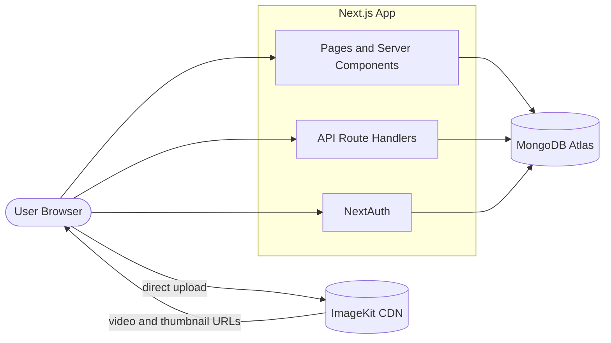
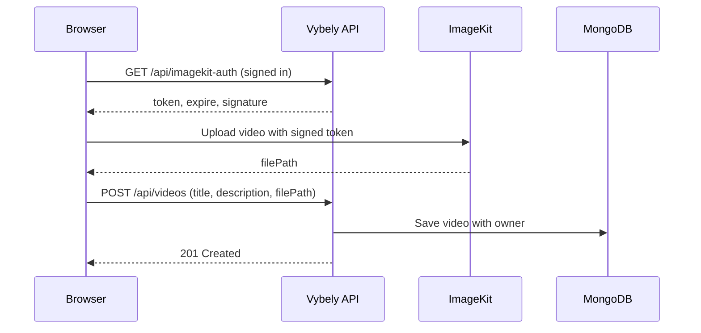

<div align="center">


<p>
  A modern short-video community where creators upload reels, discover each other and show some love.
</p>

<p>
  <a href="https://nextjs.org"></a>
  <a href="https://react.dev"></a>
  <a href="https://www.typescriptlang.org"></a>
  <a href="https://tailwindcss.com"></a>
  <a href="https://daisyui.com"></a>
  <a href="https://www.mongodb.com/atlas"></a>
</p>

<p>
  
  
  
  
</p>

<h4>
  <a href="#-quick-start">Quick Start</a>
  <span> · </span>
  <a href="#-features">Features</a>
  <span> · </span>
  <a href="#-architecture">Architecture</a>
  <span> · </span>
  <a href="#-api-reference">API</a>
  <span> · </span>
  <a href="#-design-system">Design</a>
  <span> · </span>
  <a href="#-deployment">Deploy</a>
</h4>

</div>

<br />

## 📖 Table of Contents

- [About](#-about)
- [Features](#-features)
- [Preview](#-preview)
- [Tech Stack](#-tech-stack)
- [Architecture](#-architecture)
- [Quick Start](#-quick-start)
- [API Reference](#-api-reference)
- [Data Models](#-data-models)
- [Security](#-security)
- [Project Structure](#-project-structure)
- [Design System](#-design-system)
- [Deployment](#-deployment)
- [Roadmap](#-roadmap)
- [Contributing](#-contributing)

<br />

## 💜 About

**Vybely** is a full-stack short-video platform built with the Next.js App Router. Videos are uploaded straight from the browser to ImageKit using short-lived signed tokens, while MongoDB stores only lightweight metadata. The result is a fast, scalable and cheap-to-run app with a polished dark UI.

<br />

## ✨ Features

<table>
  <tr>
    <td width="50%" valign="top">

### 🔐 Authentication
Email and password sign up / sign in with NextAuth JWT sessions. Passwords are hashed with bcrypt and never returned by the API.

  </td>
    <td width="50%" valign="top">

### 🎬 Reel uploads
Direct-to-ImageKit uploads up to **100 MB** with live progress, file validation and auto-generated thumbnails.

  </td>
  </tr>
  <tr>
    <td valign="top">

### 🏠 Discovery feed
Server-rendered public feed with **New** and **Popular** badges and a responsive card grid.

  </td>
    <td valign="top">

### ❤️ Likes
One like per user, optimistic UI updates with automatic rollback, and atomic database writes.

  </td>
  </tr>
  <tr>
    <td valign="top">

### 👤 Creator profile
Personal page with video and like stats. Owners can delete their own videos.

  </td>
    <td valign="top">

### 📺 Video page
Dedicated page for every video with player, author, date, description and SEO-friendly title.

  </td>
  </tr>
  <tr>
    <td valign="top">

### ✅ Validated forms
Login, register and upload forms use **react-hook-form** with clear inline error messages.

  </td>
    <td valign="top">

### 🎨 Custom theme
A dedicated dark **daisyUI** theme built on the Vybely brand palette. Fully responsive.

  </td>
  </tr>
</table>

<br />

## 🖼️ Preview

> Add your screenshots to a `docs/` folder and update the paths below.

| Home | Upload | Profile |
| :---: | :---: | :---: |
|  |  |  |

<br />

## 🧰 Tech Stack

<div align="center">


</div>

| Layer | Technology | Purpose |
| --- | --- | --- |
| **Framework** | Next.js 16 (App Router), React 19 | Server components, routing, API route handlers |
| **Language** | TypeScript | End-to-end type safety |
| **Styling** | Tailwind CSS 4, daisyUI 5 | Utility styling and ready-made components |
| **Forms** | react-hook-form | Performant forms with validation |
| **Icons** | lucide-react | Consistent icon set |
| **Database** | MongoDB, Mongoose | Users, videos and likes |
| **Auth** | NextAuth.js, bcryptjs | Credentials login and password hashing |
| **Media** | ImageKit | Video upload, storage and delivery |

<br />

## 🏗️ Architecture



### Upload flow



<br />

## 🚀 Quick Start

### Prerequisites

- **Node.js** 20 or newer
- A **MongoDB Atlas** cluster
- An **ImageKit** account

### Installation

```bash
# 1. Clone the repository
git clone https://github.com/<your-username>/vybely-app.git
cd vybely-app

# 2. Install dependencies
npm install

# 3. Create your environment file and fill in the values
cp .env.example .env        # Windows PowerShell: Copy-Item .env.example .env

# 4. Run the development server
npm run dev
```

Open **http://localhost:3000** and create your first account.

### Environment variables

| Variable | Required | Description |
| --- | :---: | --- |
| `MONGODB_URI` | ✅ | MongoDB connection string |
| `NEXTAUTH_SECRET` | ✅ | Session signing secret. Generate with `openssl rand -base64 32` |
| `NEXTAUTH_URL` | ✅ | Public app URL, e.g. `http://localhost:3000` |
| `NEXT_PUBLIC_PUBLIC_KEY` | ✅ | ImageKit public key |
| `NEXT_PUBLIC_URL_ENDPOINT` | ✅ | ImageKit URL endpoint |
| `IMAGEKIT_PRIVATE_KEY` | ✅ | ImageKit private key (server only) |

> [!WARNING]
> Never commit your `.env` file or share your private keys. `.env` is already listed in `.gitignore`.

> [!TIP]
> Write values without quotes or spaces around `=`, for example `IMAGEKIT_PRIVATE_KEY=private_xxx`. Restart the dev server after every `.env` change.

### Available scripts

| Command | Description |
| --- | --- |
| `npm run dev` | Start the development server |
| `npm run build` | Create an optimized production build |
| `npm run start` | Serve the production build |
| `npm run lint` | Run ESLint |

<br />

## 📡 API Reference

| Method | Endpoint | Auth | Description |
| :---: | --- | :---: | --- |
| `POST` | `/api/auth/register` | 🔓 | Create a new account |
| `*` | `/api/auth/[...nextauth]` | 🔓 | NextAuth sign in, sign out and session |
| `GET` | `/api/imagekit-auth` | 🔒 | Signed ImageKit upload credentials |
| `GET` | `/api/videos` | 🔓 | List videos, newest first |
| `POST` | `/api/videos` | 🔒 | Publish a new video |
| `DELETE` | `/api/videos/:id` | 🔒 | Delete a video (owner only) |
| `POST` | `/api/videos/:id/like` | 🔒 | Toggle like on a video |

<details>
<summary><b>Example: publish a video</b></summary>

<br />

```http
POST /api/videos
Content-Type: application/json
```

```json
{
  "title": "Sunset vibes",
  "description": "Golden hour at the beach.",
  "videoUrl": "/videos/sunset_abc123.mp4",
  "thumbnailUrl": "https://ik.imagekit.io/your_id/videos/sunset_abc123.mp4/ik-thumbnail.jpg"
}
```

**Response** `201 Created`

```json
{ "_id": "6730f1c2a9b1e4d5c8f0a123" }
```

</details>

<br />

## 🗄️ Data Models

<table>
  <tr>
    <td valign="top" width="50%">

**User**

| Field | Type |
| --- | --- |
| `email` | String, unique |
| `password` | String, bcrypt hash |
| `createdAt` | Date |

  </td>
    <td valign="top" width="50%">

**Video**

| Field | Type |
| --- | --- |
| `title` | String, max 100 |
| `description` | String, max 2000 |
| `videoUrl` | String |
| `thumbnailUrl` | String |
| `userId` | ObjectId, ref User |
| `likes` | ObjectId[], ref User |
| `createdAt` | Date |

  </td>
  </tr>
</table>

<br />

## 🛡️ Security

- Passwords are hashed with **bcrypt** before they are stored.
- Upload tokens are **signed on the server** and expire quickly; the private key never reaches the browser.
- `/upload` and `/profile` are protected with server-side session checks.
- Write endpoints verify the session, and **only the owner** can delete a video.
- Likes use `$addToSet` and `$pull`, so a user can never like the same video twice.
- Only the part of an email before `@` is shown publicly. Full emails are never exposed by the API.

<br />

## 📁 Project Structure

```text
vybely-app/
├── app/
│   ├── api/
│   │   ├── auth/              # NextAuth handler and register route
│   │   ├── imagekit-auth/     # Signed upload credentials
│   │   └── videos/            # Feed, create, delete and like routes
│   ├── components/            # Header, VideoComponent, forms, buttons
│   ├── login/  register/      # Authentication pages
│   ├── upload/  profile/      # Protected pages
│   ├── videos/[id]/           # Video detail page
│   ├── globals.css            # Tailwind and daisyUI theme
│   └── layout.tsx             # Root layout
├── lib/                       # DB connection, auth config, data helpers
├── models/                    # Mongoose models (User, Video)
└── .env.example               # Environment template
```

<br />

## 🎨 Design System

The custom daisyUI theme **`vybely`** is defined in [`app/globals.css`](app/globals.css).

| Swatch | Color | Hex | Usage |
| :---: | --- | --- | --- |
|  | Violet | `#7C3AED` | Primary brand, buttons |
|  | Pink | `#EC4899` | Likes, highlights |
|  | Cyan | `#06B6D4` | Links, active states |
|  | Amber | `#F59E0B` | Badges, special highlights |
|  | Purple Light | `#A78BFA` | Secondary accents |

<br />

## 🌐 Deployment

Deploying to [Vercel](https://vercel.com/new) takes a few minutes:

1. Push the repository to GitHub and import it on Vercel.
2. Add every variable from the [environment table](#environment-variables).
3. Set `NEXTAUTH_URL` to your production domain.
4. In MongoDB Atlas, allow network access from Vercel (or `0.0.0.0/0`).
5. Deploy.

<br />

## 🗺️ Roadmap

- [x] Authentication with NextAuth
- [x] Direct video uploads to ImageKit
- [x] Likes, profile and video detail page
- [ ] Comments
- [ ] Follow creators
- [ ] Search and hashtags
- [ ] Edit video details
- [ ] Remove files from ImageKit when a video is deleted

> [!NOTE]
> Deleting a video currently removes it from the database only. The file stays in your ImageKit media library.

<br />

## 🤝 Contributing

Contributions, issues and feature requests are welcome.

1. Fork the project
2. Create your branch: `git checkout -b feature/amazing-feature`
3. Commit your changes: `git commit -m "feat: add amazing feature"`
4. Push the branch: `git push origin feature/amazing-feature`
5. Open a Pull Request

<br />

## 📄 License

Released under the **MIT License**. Add a `LICENSE` file to the repository root to make it official.

<br />

<div align="center">

**Made with 💜 for creators**

<a href="#top">⬆ Back to top</a>


</div>